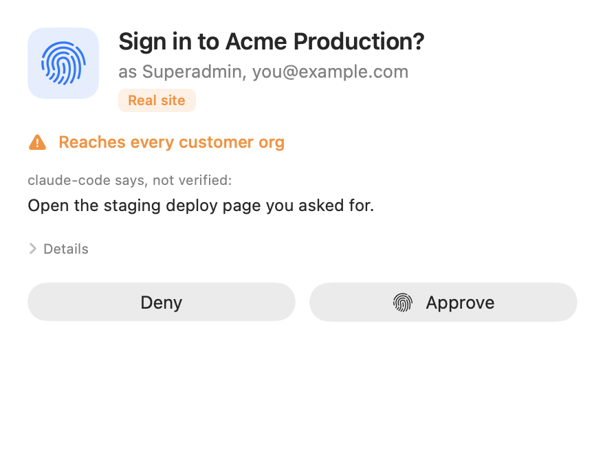
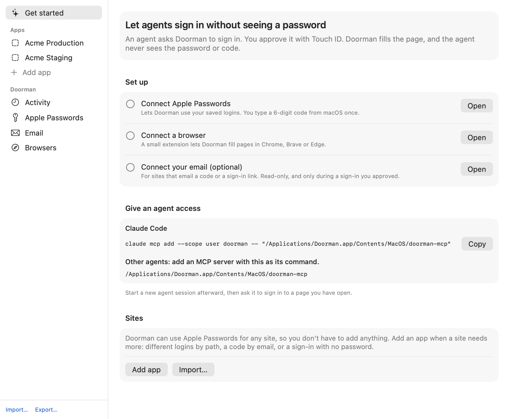
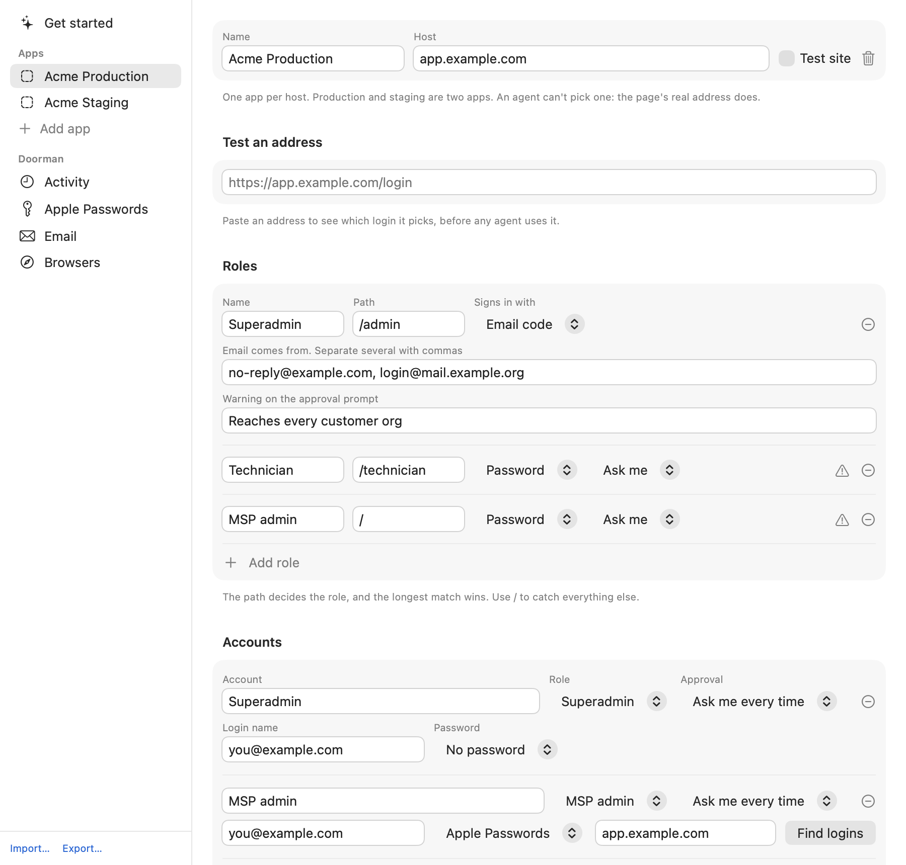

<h1 align="center">
  <picture>
    <source media="(prefers-color-scheme: dark)" srcset="assets/brand/logo-dark.svg">
    
  </picture>
</h1>

<p align="center"><strong>Lets AI agents sign in to websites without ever seeing your password.</strong></p>

<p align="center">
  
  
  
</p>

An agent asks Doorman to sign in. You approve with Touch ID. Doorman gets the password from Apple Passwords, fills the page, handles an emailed code or sign-in link if the site asks for one, and tells the agent `signed_in`. The agent never sees the password or the code.

<p align="center">
  
</p>

It works with any agent that supports MCP, including Claude Code, and on any site with a login saved in Apple Passwords, with nothing to set up per site.

> **This is an early version.** It reaches Apple Passwords through Apple's private browser helper, which an update could break. Read [what it protects, and what it doesn't](docs/SECURITY.md) before using it on accounts that matter.

## Install

You need macOS 14 or later, and Chrome, Brave or Edge.

1. Download `Doorman-x.y.z.dmg` from [Releases](../../releases) and drag **Doorman** onto **Applications**.
2. Open it. macOS says it can't check the app, because Doorman isn't signed by a paid Apple developer account. Click **Done**, then go to **System Settings → Privacy & Security**, scroll down and click **Open Anyway**.
3. A key appears in your menu bar. Click it, then **Accounts and activity**, and follow **Get started**.

Or build it yourself with `make install`. You'll need Xcode.

## Set up

**Get started** walks you through these, and shows what's done.

<p align="center">
  
</p>

1. **Connect Apple Passwords.** Click **Connect**, then **Start pairing**. macOS shows a 6-digit code, and you type it into Doorman. You'll do this again each time Doorman restarts.
2. **Connect a browser.** Open `chrome://extensions`, turn on **Developer mode**, click **Show extension folder** in Doorman, and drag that folder onto the page.
3. **Connect your email (optional).** For sites that email a code or a link. See [Email](#email).
4. **Give an agent access.** For Claude Code, copy the command from **Get started**. It looks like this:

   ```bash
   claude mcp add --scope user doorman -- "/Applications/Doorman.app/Contents/MacOS/doorman-mcp"
   ```

   This also covers the Code tab in the Claude desktop app. For the app's Chat tab, see [Claude desktop app](#claude-desktop-app). For other agents, add an MCP server with that path as its command.

Start a new agent session, open a page that needs a login, and ask the agent to sign in.

### Claude desktop app

The desktop app's Chat tab has its own list of MCP servers, and doesn't see ones added with `claude mcp add`.

1. **Quit Claude with ⌘Q.** Closing the window isn't enough. Claude saves its config when it quits, which overwrites anything you changed while it was open.
2. Open the config file. If it doesn't exist yet, create it with `{ "mcpServers": {} }` in it.

   ```bash
   open -a TextEdit "$HOME/Library/Application Support/Claude/claude_desktop_config.json"
   ```

3. Add Doorman inside `mcpServers`, with a comma after the entry before it, and save.

   ```json
   "doorman": {
     "command": "/Applications/Doorman.app/Contents/MacOS/doorman-mcp"
   }
   ```

   If you built it yourself with `make install`, use `/Users/YOU/Applications/Doorman.app/Contents/MacOS/doorman-mcp` instead.

4. Open Claude again. Doorman should appear with your other local servers.

## How a sign-in works

1. The agent calls `sign_in` with the page's address.
2. A popup appears over whatever you're doing, without bringing up Doorman's window. It shows the site and the login. Press Return or click **Approve**, then use Touch ID.
3. Doorman checks the page's real address, fills it, and submits. A note in the corner shows each step.
4. If the site asks for a code, Doorman gets it from Apple Passwords or your email, or asks you to type it into Doorman.
5. The agent gets a status back: `filled`, `nothing_to_fill`, `denied`, `needs_you`, `failed`, `timeout`, `paused` or `pending`. Doorman doesn't judge whether you're signed in. The agent looks at the page, and handles anything that isn't a secret itself, like picking an account or pressing Continue.

The agent never gets a password, a code or the contents of an email. Every attempt is listed under **Activity**.

## Sites

**You don't have to add anything.** For a site you haven't added, Doorman looks for a saved login in Apple Passwords and always asks you first. You can turn this off, or list sites it must never use, on the **Apple Passwords** page.

**Add an app** when a site needs more:

| You want | Set |
|---|---|
| Production and staging kept apart | One app per host |
| Different logins for different paths | A role per path, like `/admin` and `/` |
| Sign-in by emailed code or link | The role's sign-in method, and who the email comes from |
| A warning on the popup | The role's warning, like "Reaches every customer" |
| A choice of accounts for the agent | Several accounts on a role |
| No popup on a test account | The account's Approval |

<p align="center">
  
</p>

Use **Test an address** to see which login an address picks. There's a sample to import in [`examples/acme.json`](examples/acme.json).

## Email

For sites that send a code or a sign-in link. Doorman only looks during a sign-in you approved, only for mail from that role's sender, and only from the last few minutes. It can't change or delete anything, and it never stores mail or shows it to an agent. A message also has to pass your mail server's DKIM or DMARC checks, so a forged sender doesn't count.

**Gmail:**
1. In [Google Cloud](https://console.cloud.google.com/), create a project and enable the **Gmail API**.
2. Under **Google Auth Platform**, set up the consent screen and add yourself as a test user.
3. Create an OAuth client of type **Desktop app**.
4. In Doorman, go to **Email**, choose **Gmail**, paste the client ID and secret, and click **Connect Gmail**.

While the Google project is in testing mode, Google makes you reconnect about once a week. If your mail is on a work or school account, its admin may block this.

**IMAP:** go to **Email**, choose **IMAP**, and enter the server and an app password.

With no mailbox connected, Doorman asks you to type the code into it instead.

## Browsers and agents

| Where the agent is working | How Doorman reaches it |
|---|---|
| Chrome, Brave or Edge, including Claude in Chrome and Playwriter | The extension |
| Claude's built-in browser | macOS Accessibility. Turn it on under **Browsers**. The pane has to be showing, and email links don't work there yet |
| A browser the agent starts itself, like Playwright or browser-use | The agent calls `sign_in` with `session_file: true`. Doorman signs in inside a hidden browser and returns a short-lived file for `--storage-state` or `storage_state` |

MCP tools: `sign_in`, `check_sign_in`, `sign_in_options` and `doorman_status`. None of them can return a password or a code.

## Troubleshooting

| What you see | What to do |
|---|---|
| macOS asks for your Keychain password | Choose **Always Allow**. It asks again after an update, because macOS treats each build as a new app |
| Doorman says it has no Accessibility permission, but the switch is on | macOS is remembering an older build. In System Settings, remove Doorman from the Accessibility list with **−**, then add it again |
| Doorman doesn't appear in the Claude desktop app | Claude overwrote your edit when it quit. [Quit it first](#claude-desktop-app), then edit the config |
| The extension won't connect | Open Doorman first, then click reload on `chrome://extensions` |
| `no_window` in Claude's browser | The pane has to be showing |
| `mail_not_found` | Check who the email really comes from, and set that as the role's sender |
| `mail_not_verified` | The email arrived, but your mail server couldn't confirm the sender, so Doorman ignored it |
| A banner says settings changed outside Doorman | Something edited the settings file. Sign-ins stop until you review it and save, or start over |

## Build from source

```bash
make install    # build, copy to ~/Applications, and open
make test       # unit tests
make e2e        # real Chrome, the real extension and MCP server, against the demo site
make demo       # a pretend site for trying it with nothing real at stake
make snapshots  # render every screen to snapshots/
make package    # a universal disk image in dist/
```

To try it safely, see [docs/TRY_IT.md](docs/TRY_IT.md). For how it's put together, see [docs/ARCHITECTURE.md](docs/ARCHITECTURE.md).

## Not supported yet

Passkeys, SMS codes, CAPTCHAs (Doorman hands those back to you) and single sign-on through Google or Microsoft. Doorman doesn't have a paid Apple signature yet, which is why installing takes an extra step.

Doorman isn't made by or affiliated with Apple.
